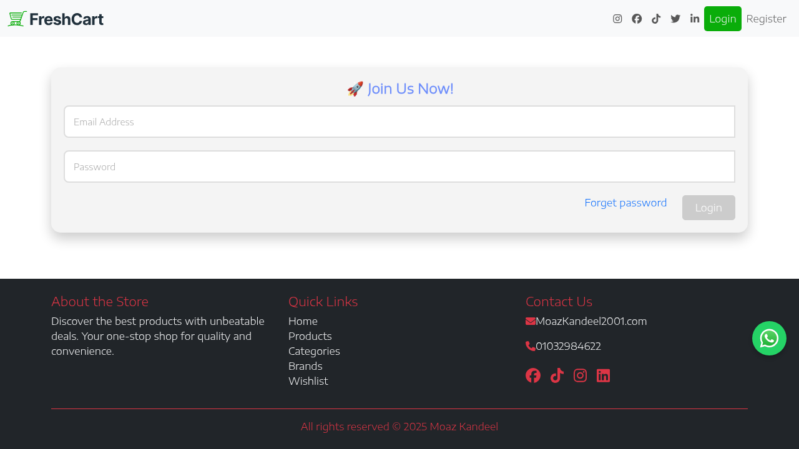

# E_commerceAng

A responsive e-commerce store built with Angular, consuming a live product API. Users can browse products, categories and brands, search, manage a cart and wishlist, register and log in, and review their orders.



**Live demo:** https://moazkandeel.github.io/E_commerceAng

## Features

- Product catalog with category and brand filtering, search pipe and details pages
- Cart and wishlist management
- Full auth flow: register, login, forgot password (JWT), route guards
- Orders page per user
- Carousel sliders and loading spinners

## Tech stack

Angular 16, TypeScript, RxJS, Angular Router, Bootstrap 5, ngx-owl-carousel, ngx-spinner, jwt-decode

## Run locally

```bash
npm install
ng serve
```

The app runs on http://localhost:4200 and talks to a public products API.
